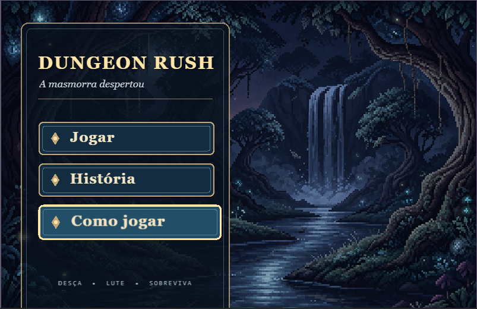
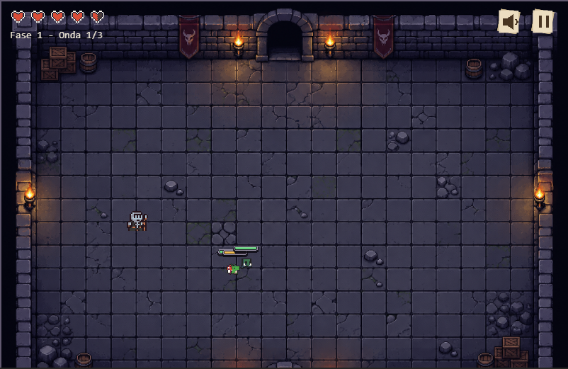
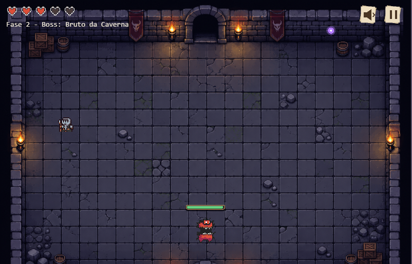
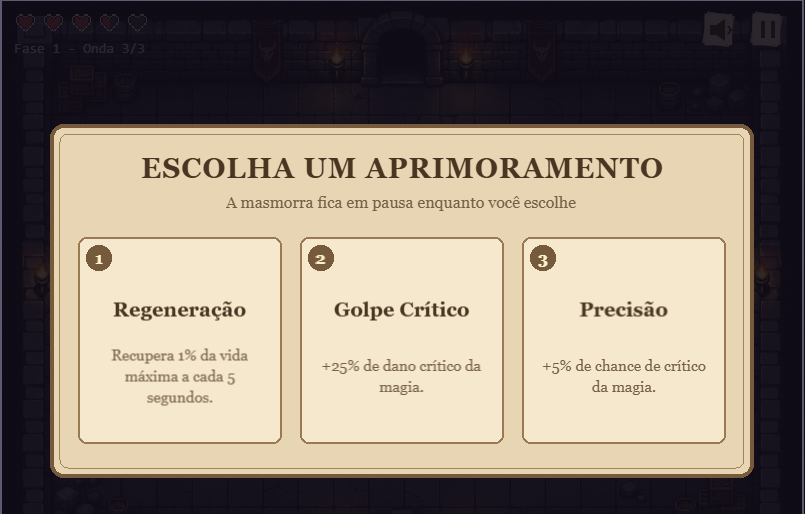
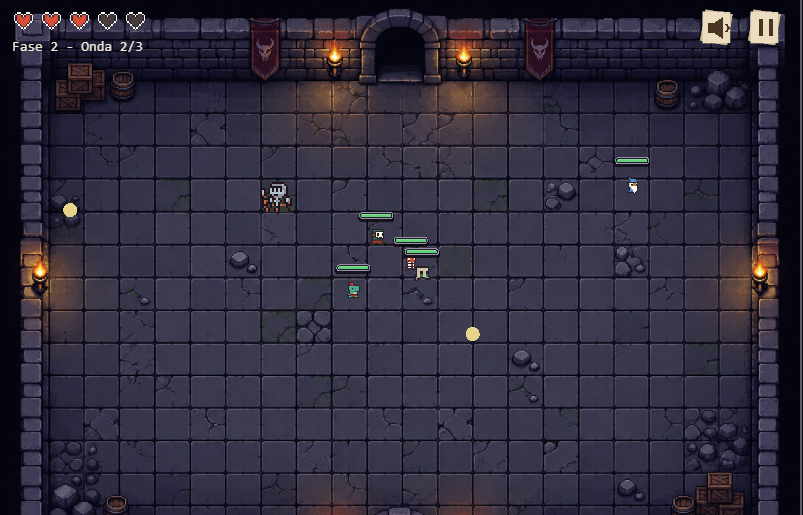

# 🏰 DungeonFall

**A masmorra despertou. Desça, lute e sobreviva!**

## 📖 Sobre o jogo

DungeonFall é um jogo de ação e sobrevivência ambientado em uma antiga masmorra tomada por uma força mágica corrompida. No papel de um jovem mago, o jogador deve enfrentar criaturas perigosas, sobreviver às ondas de inimigos e avançar pelos desafios da masmorra.

### História

Há muitos anos, uma antiga masmorra surgiu nas profundezas de uma montanha próxima a uma pequena vila.

Segundo antigas lendas, aquele lugar foi construído para guardar uma poderosa fonte de energia mágica. Um antigo Guardião foi encarregado de proteger esse poder e impedir que caísse nas mãos erradas.

Durante séculos, a masmorra permaneceu adormecida. Porém, algo mudou.

O Guardião, antes responsável por manter o equilíbrio daquele lugar, acabou sendo consumido pela própria fonte de energia que deveria proteger. Sua corrupção se espalhou por toda a masmorra, transformando criaturas pacíficas em monstros violentos e fazendo com que a própria estrutura do lugar se tornasse hostil.

Com o passar do tempo, criaturas começaram a abandonar as profundezas e atacar a vila próxima. Moradores desapareceram, plantações foram destruídas e o medo tomou conta da população.

Um jovem mago, aprendiz de um poderoso feiticeiro chamado Aldric, decide enfrentar a ameaça. Armado com seus conhecimentos arcanos e sua habilidade de controlar a magia, ele parte em direção à masmorra para destruir a fonte da corrupção e libertar tanto a vila quanto as criaturas que vivem naquele lugar.

Entretanto, durante sua jornada, descobrirá que nem todos os monstros são seus inimigos.

## 🎯 Objetivo

Sobreviver às ondas de inimigos, derrotar os chefes que aparecem ao longo da jornada e avançar pelas fases da masmorra até concluir o desafio.

## 🛠️ Ferramentas e tecnologias

- **JavaScript** — linguagem utilizada no desenvolvimento.
- **PixiJS 8** — biblioteca de renderização gráfica 2D.
- **Vite 7** — ferramenta utilizada para executar o ambiente de desenvolvimento e gerar a versão de produção.
- **HTML5 e CSS3** — estrutura e apresentação da aplicação no navegador.

## 🎮 Como jogar

| Ação | Tecla |
|---|---|
| Movimentar o personagem | `W`, `A`, `S`, `D` ou teclas direcionais (`↑`, `↓`, `←`, `→`) |
| Lançar magia | `J` ou `Espaço` |
| Pausar ou continuar | `P` ou `Esc` |
| Escolher uma melhoria | `1`, `2` ou `3` |
| Avançar pela introdução | `Enter` ou `Espaço` |

A magia é lançada na direção para a qual o personagem estiver olhando. Também é possível utilizar os botões exibidos na tela, como os controles de pausa e áudio.

## 💻 Instalação e execução

### Pré-requisitos

- [Node.js](https://nodejs.org/) instalado (com npm).
- Git instalado, caso queira clonar o repositório.

### 1. Clone o repositório

```bash
git clone URL_DO_REPOSITORIO
```

> Substitua `URL_DO_REPOSITORIO` pelo endereço HTTPS do repositório no GitHub. Se você já baixou os arquivos do projeto, pode pular esta etapa.

### 2. Entre na pasta do projeto

```bash
cd jogo-pixijs-main
```

### 3. Instale as dependências

```bash
npm install
```

### 4. Inicie o jogo

```bash
npm run dev
```

O Vite exibirá no terminal o endereço local para acessar o jogo, normalmente `http://localhost:5173`. Abra esse endereço em um navegador.

### 5. Gerar a versão de produção

Para gerar os arquivos otimizados do projeto, execute:

```bash
npm run build
```

Os arquivos gerados ficarão na pasta `dist/`.

## 🖼️ Capturas de tela

### Menu principal



### Jogabilidade — Fase 1



### Enfrentando um chefe



### Escolha de aprimoramentos



### Jogabilidade — Fase 2



## 🎨 Créditos dos recursos gráficos

Parte dos recursos visuais utilizados no jogo foi obtida no pacote **DungeonTileset II**, disponibilizado por **0x72**. Foram utilizados recursos como inimigos, barra de vida, elementos da interface (UI) e retratos (portraits).

- Criador: [0x72](https://0x72.itch.io/dungeontileset-ii)
- Pacote: [DungeonTileset II](https://0x72.itch.io/dungeontileset-ii)

## 👥 Integrantes Grupo 19

- **Augusto Cezar de Almeida Pinto**
- **Renan Rodrigues da Silva**

## ▶️ Acesso ao jogo

O jogo pode ser executado localmente seguindo as instruções de instalação e execução acima. Um link público para jogar diretamente pelo navegador poderá ser adicionado aqui caso o projeto seja publicado em uma plataforma de hospedagem.
